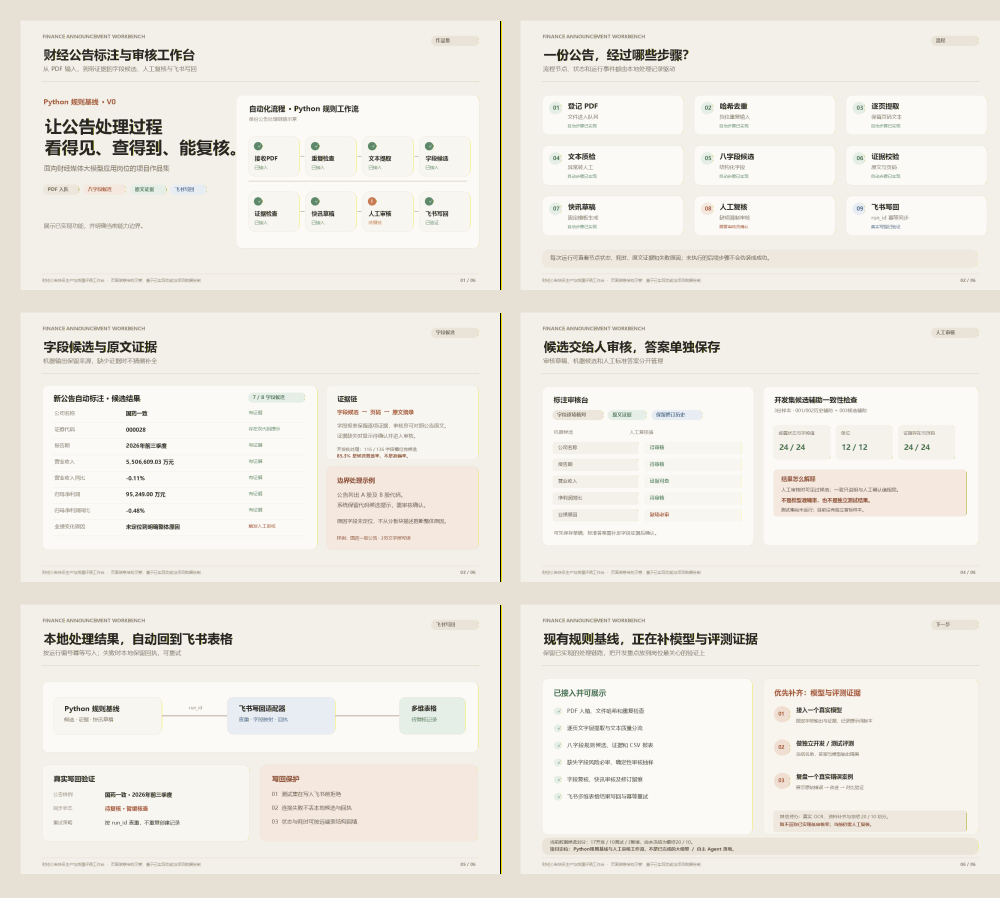

# 财经公告标注与质量评测工作台

> 面向财经媒体大模型应用岗位的个人项目原型：把上市公司业绩快报 PDF 转成可追溯的字段候选、快讯草稿和审核记录。

**Python 规则基线 · 飞书多维表格 · 单 Agent 工作流方向**

[打开展示页源码](./index.html) · [查看作品集 PDF](./assets/财经公告工作台_作品集展示页.pdf) · [查看六页总览图](./assets/作品集总览.png)

## 项目解决什么问题

财经公告结构化标注需要同时保证字段完整、数字和单位准确、结果能回到原文核查。这个项目围绕业绩快报搭建一条可审核的处理链路：

**公告 PDF → 样本核验 → 文本提取 → 八字段候选与原文证据 → 快讯草稿 → 人工审核 → 质量诊断 → 飞书写回**

重点是让每项候选结果保留页码和证据，让机器输出、人工修订和最终确认答案可以区分和追溯。

## 当前已实现

- 导入公告 PDF，维护样本清单和独立运行记录。
- 使用 Python 规则基线生成八项字段候选，保留原文证据与页码。
- 生成有依据的快讯草稿；找不到原文依据时保留待审核状态，不自动补写。
- 在本地工作台查看流程、候选结果、证据和运行状态，并进行人工审核与修订。
- 将运行结果写回飞书多维表格，记录同步状态并处理重复写回。
- 在飞书中展示运行状态、候选覆盖情况和质量诊断相关图表。

## 数据与结果口径

以下为 **2026-10-24 的静态项目快照**，不是实时飞书数据：

| 指标 | 当前记录 | 解释 |
| --- | ---: | --- |
| 已盘点 PDF | 33 份 | 原始文件保留并登记 |
| 核心字段 | 8 项 | 公司、代码、报告期、收入与净利润及其同比、业绩变化原因等 |
| 已确认种子答案 | 5 份 | 用于开发规则和审核流程 |
| 开发 / 测试候选 | 18 / 10 份 | 划分尚未冻结；测试集尚未运行 |
| 单份新公告候选覆盖 | 7 / 8 字段（87.5%） | 只表示产生候选的字段比例，不代表字段准确率 |

开发集一致性诊断覆盖 3 份候选辅助标注样本。这些结果可用于检查字段和值的整理流程，**不能称为独立测试准确率**。测试样本仍保持隔离。

## 技术与工作流

- **处理：** Python，规则匹配、字段标准化、证据关联和快讯模板生成。
- **工作台：** 本地网页展示处理步骤、单份公告结果、审核状态和运行记录。
- **协作与报表：** 飞书多维表格保存样本、运行和审核结果，飞书图表呈现汇总指标。
- **质量控制：** 区分机器候选、人工修订和确认答案；保留失败状态与待核查原因。

## 当前边界与下一步

- 真实大模型 API 尚未配置；当前候选由 Python 规则基线生成。
- OCR 引擎接入尚未完成；扫描件识别能力仍需补充。
- 18/10 开发与测试候选名单尚未冻结，独立测试集尚未运行。
- 目前展示的是个人项目原型和真实项目运行快照，不代表已在企业生产环境稳定运行。

后续重点是接入可切换的模型 API 与提示词配置，冻结数据划分，并在不读取测试答案的前提下比较规则基线和模型方案。

## 相关材料

- [项目展示页](./index.html)
- [六页作品集 PDF](./assets/财经公告工作台_作品集展示页.pdf)
- [六页总览图](./assets/作品集总览.png)
- [旧版项目作品集 PDF](./assets/财经公告快讯工作台_作品集.pdf)

飞书原生报表需要使用有对应权限的组织账号访问。GitHub Pages 上的本页和附件为公开内容；页面中的数据是静态快照，不会读取访问者的飞书账号或实时数据。
